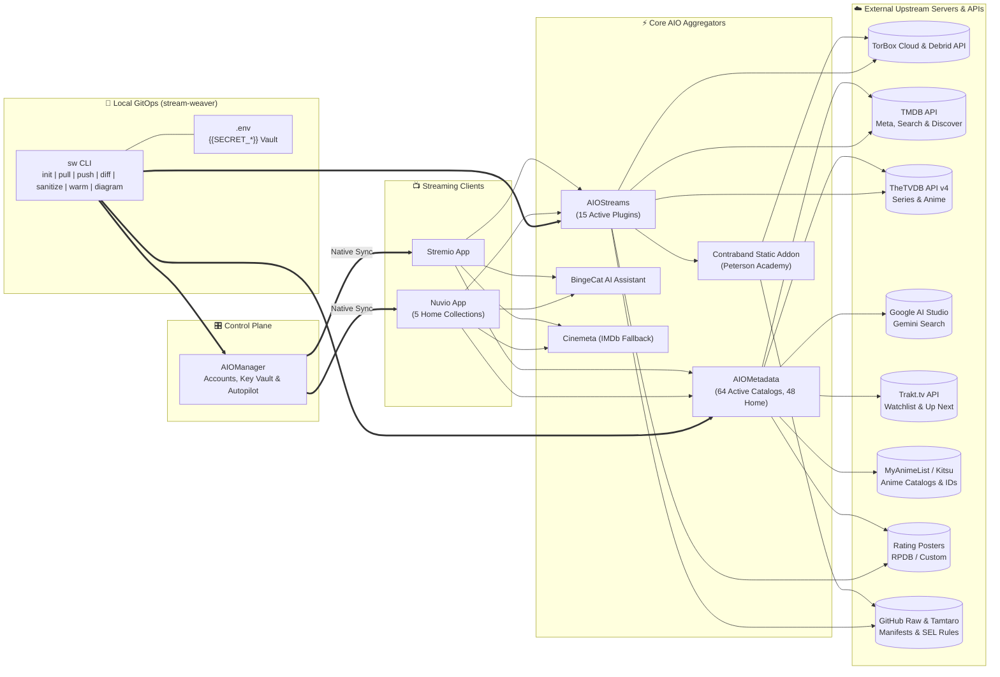
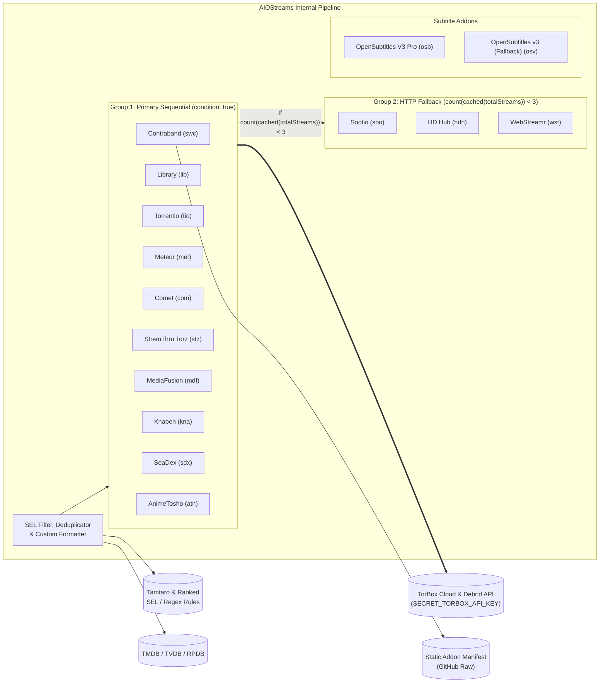
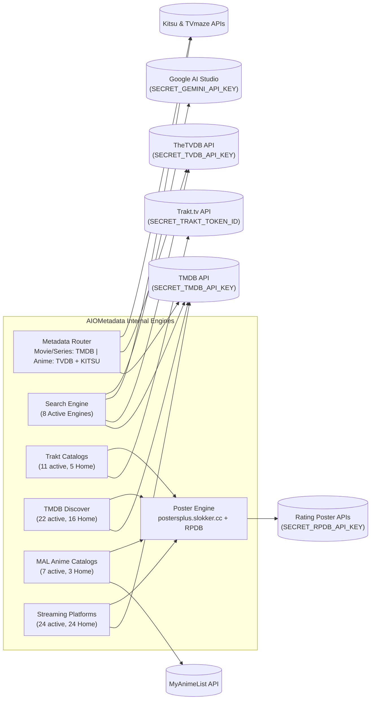

# Stream Weaver — Live System Architecture & Topology

> **Auto-Generated Architecture-as-Code:** This file and [`architecture/topology.c4`](architecture/topology.c4) are deterministically compiled from [`configs/aiomanager.json`](configs/aiomanager.json), [`configs/aiostreams.json`](configs/aiostreams.json), [`configs/aiometadata.json`](configs/aiometadata.json), and [`configs/nuvio_collections.json`](configs/nuvio_collections.json) via `uv run sw diagram` (and automatically updated on `sw pull`, `sw push`, `sw sanitize`, and `git commit`).

## Interactive Drill-Down Explorer (LikeC4 — 10 Views)

For the interactive, Google-Maps-style zoomable graph with **10 perspectives** (`index`, `aiomanager_view`, `nuvio_collections_view`, `aiostreams_view`, `aiometadata_view`, `contraband_view`, `secrets_view`, `stream_resolution_flow`, `gitops_sync_flow`, `ai_search_flow`):

```bash
# Regenerate topology from configs/*.json at any time:
uv run sw diagram

# Launch the interactive LikeC4 web explorer locally:
npx likec4 start architecture

# Or build a standalone static HTML site (also automated via GitHub Actions -> GitHub Pages):
npx likec4 build architecture -o dist/architecture
```

*(Tip: You can also install the **LikeC4** extension in VS Code / Cursor / Antigravity and open [`architecture/topology.c4`](architecture/topology.c4) directly in the editor.)*

---

## 1. Overarching System Landscape (Level 1–2)



---

## 2. AIOStreams Internal Pipeline & Upstream Connections



### Active AIOStreams Plugins (`configs/aiostreams.json`)

| ID | Plugin Name | Preset Type | Execution Group | Resources | Upstream Dependency |
| :--- | :--- | :--- | :--- | :--- | :--- |
| `swc` | **Contraband** | `custom` | Group 1 (Primary) | `catalog, meta, stream` | Static Manifest + Torbox |
| `lib` | **Library** | `library` | Group 1 (Primary) | `stream, catalog, meta` | Torbox Cloud Library (`SECRET_TORBOX_API_KEY`) |
| `tio` | **Torrentio** | `torrentio` | Group 1 (Primary) | `stream` | Torbox Cache + Public Indexers |
| `met` | **Meteor** | `meteor` | Group 1 (Primary) | `stream` | Torbox Cache + Public Indexers |
| `com` | **Comet** | `comet` | Group 1 (Primary) | `stream` | Torbox Cache + Public Indexers |
| `stz` | **StremThru Torz** | `stremthruTorz` | Group 1 (Primary) | `stream` | Torbox Cache + Public Indexers |
| `mdf` | **MediaFusion** | `mediafusion` | Group 1 (Primary) | `stream` | Torbox Cache + Public Indexers |
| `kna` | **Knaben** | `knaben` | Group 1 (Primary) | `stream` | Torbox Cache + Public Indexers |
| `sdx` | **SeaDex** | `seadex` | Group 1 (Primary) | `stream` | Torbox Cache + Public Indexers |
| `atn` | **AnimeTosho** | `animetosho` | Group 1 (Primary) | `stream` | Torbox Cache + Public Indexers |
| `soo` | **Sootio** | `sootio` | Group 2 (`count(cached(totalStreams)) < 3`) | `stream` | Direct HTTP Providers |
| `hdh` | **HD Hub** | `hdhub` | Group 2 (`count(cached(totalStreams)) < 3`) | `stream` | Direct HTTP Providers |
| `wst` | **WebStreamr** | `webstreamr` | Group 2 (`count(cached(totalStreams)) < 3`) | `stream` | Direct HTTP Providers |
| `osb` | **OpenSubtitles V3 Pro** | `opensubtitles-v3-plus` | Subtitles / Utility | `subtitles` | OpenSubtitles API |
| `osv` | **OpenSubtitles v3 (Fallback)** | `opensubtitles` | Subtitles / Utility | `subtitles` | OpenSubtitles API |

---

## 3. AIOMetadata Internal Engines & External Servers



---

## 4. Nuvio Curated Home Collections (`configs/nuvio_collections.json`)

| Collection ID | Title | Tabbed Folders | Upstream Addons |
| :--- | :--- | :--- | :--- |
| `col-for-you-discovery` | **For You & Discovery** (5) | AI Picks For You, Because You Watched, Trending & Popular, Top Rated All-Time, Watchlist & Cloud Library | AIOMetadata, AIOStreams, BingeCat |
| `col-streaming-services` | **Streaming Services** (8) | Netflix, Prime Video, Apple TV+, HBO Max, Disney+, Hulu, Paramount+, Peacock | AIOMetadata |
| `col-indian-cinema` | **Indian Cinema & Regional OTT** (5) | Kannada Cinema, Hindi Cinema & Series, JioHotstar, Sony LIV, ZEE5 | AIOMetadata |
| `col-anime-japanese` | **Anime & Japanese** (3) | Airing & Popular Anime, Top Rated Anime, Japanese Cinema & Drama | AIOMetadata |
| `col-courses-docs` | **Courses & Documentaries** (3) | Peterson Academy, Curiosity Stream, Top Documentaries & Docuseries | AIOMetadata, AIOStreams |

---

## 5. Nuvio Stream & Player Badges (`configs/nuvio_badges.json`)

| Platforms | Placement | Paused Player Logos | Active Badge Pack URLs |
| :--- | :--- | :--- | :--- |
| `tv`, `desktop`, `mobile` | `BOTTOM` | `enabled` | `https://raw.githubusercontent.com/leonevz/Elite-Badges/main/badges.json` |
