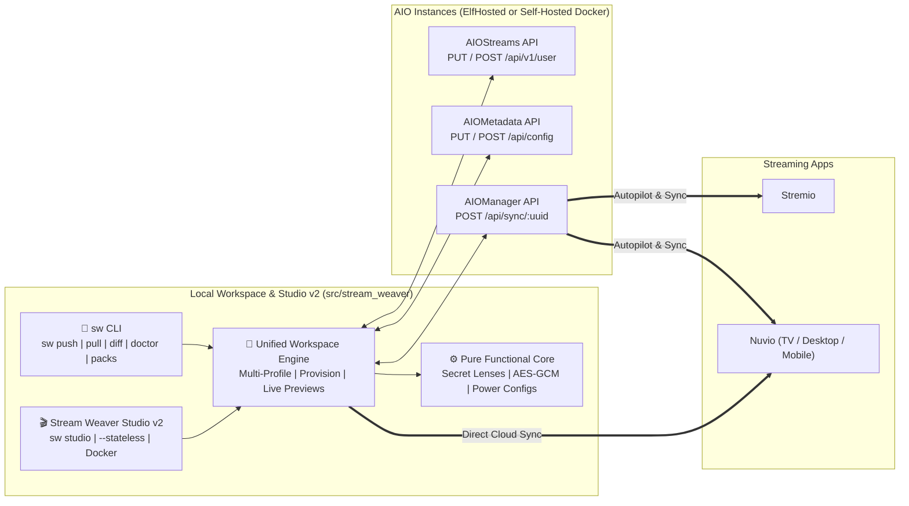

# Stream Weaver — Pure Functional Streaming Stack GitOps Control Plane

This repository (**`stream-weaver`**) is the declarative GitOps control plane for your **Stremio** + **Nuvio** streaming stack, paired with **[`aio_contraband`](https://github.com/Darshan-AS/aio_contraband)** (`dev.darshanas.contraband`) for curated niche courses, rare lectures, and unlisted specials.

It manages:
1. **[AIOStreams](https://github.com/Viren070/AIOStreams)** (`aiostreams.json`) — Stream scrapers, TorBox/Debrid services, SEL filtering/sorting, stream formatting, and the **Contraband** custom addon.
2. **[AIOMetadata](https://github.com/cedya77/aiometadata)** (`aiometadata.json`) — TMDB/TVDB/MAL/AniList metadata providers, MDBList/Trakt catalogs, artwork rules, and search.
3. **[AIOManager](https://github.com/Sonicx161/AIOManager)** (`aiomanager.json`) — Saved addon library, account profiles, Autopilot failover rules, and bidirectional Stremio $\leftrightarrow$ Nuvio sync.

> **Contraband Addon Compiler & TorBox Queue (`cb`):** The static Stremio addon compiler and TorBox ingestor now live directly inside the **[`aio_contraband`](https://github.com/Darshan-AS/aio_contraband)** repository (`../aio_contraband`) via the `cb` CLI (`uv run cb add`, `uv run cb sync`, `uv run cb watch`, `uv run cb list`).

---

## Architecture: Functional Core, Imperative Shell

`stream-weaver` is structured as a lean, strictly typed Python 3.13+ package (`src/stream_weaver/`) managed by `uv`:



### Package Layout
* `src/stream_weaver/core/` — **100% Pure Functional Core** (`@dataclass(frozen=True, slots=True)`, `Result[T, E] = Ok[T] | Err[E]`, zero I/O):
  * `secrets.py` — Declarative JSON-path `SecretLens` engine for lossless secret harvesting, scrubbing (`{{SECRET_*}}`), and injection.
  * `crypto.py` — Pure Python PBKDF2-HMAC-SHA256 + AES-256-GCM + raw deflate for AIOManager Cloud Sync (zero external Node.js dependency).
  * `coercions.py` — Pure config normalizers and AIOManager telemetry dehydration/rehydration.
  * `aiostreams_power.py`, `aiometadata_power.py`, `aiomanager_power.py` — Multi-Debrid & Usenet priority stacking, custom `manifest.json` addon wiring, stream card formatters, advanced stream filters, metadata routers, AI search, poster rating engines, and Autopilot controls.
  * `doctor.py` — Structured health diagnostics & Stremio addon manifest inspector.
* `src/stream_weaver/engine/` — **Unified Workspace Engine** (`workspace.py`): shared orchestration for CLI and Studio v2 across multi-profile management, parallel push/pull/diff, NDJSON progress streaming, live catalog poster previews, and auto-scrubbed raw document editing.
* `src/stream_weaver/studio/` — **Stream Weaver Studio v2** (`server.py` + zero-build ES-module web app in `static/`): works identically in **Local GitOps Mode** and **Zero-Persistence Stateless Browser Mode**.
* `src/stream_weaver/providers/` — **Extensible Structural Protocols (`typing.Protocol`)**:
  * `ConfigServiceProtocol` (`AIOStreamsService`, `AIOMetadataService`, `AIOManagerService`)
  * `ClientSyncProtocol` (`NuvioClientSync`, `StremioClientSync`)
* `src/stream_weaver/effects/` & `src/stream_weaver/cli/` — **Imperative Shell** (`httpx` HTTP adapter, JSON/`.env` persistence, and `typer`/`rich` CLI).

### Workspace Layout: Library → Profile → Workspace
The tool separates **code** (`stream-weaver`) from **your personal data** (which lives cleanly in its own standalone folder such as `~/my-streaming-stack`, backed by your own private Git repo), layered cleanly in three tiers:

| Layer | What lives here | Owned by |
| :--- | :--- | :--- |
| **Library** (bundled `library/`, plus local `<workspace>/library/`) | identity-free *recipes*: collection / folder / catalog / badges / meta / settings fragments, optionally parameterised (`${language}`, `for` loops) | shared upstream, or workspace-private for custom AIOStreams presets |
| **Profile** (`<workspace>/profiles/<p>/profile.json`) | one person / household member: which instances and logins they use, which Nuvio profile, plus their *taste* — `collections` as `{ref, with}` items (or inline), `badges`/`meta`/`settings` refs, `aiometadata.extraCatalogs` | the workspace maintainer |
| **Workspace** (`<workspace>/`) | identity + infrastructure: `tenant.json` (instances, logins, profiles, library roots), `.env`, raw `aiostreams.json` / `aiomanager.json`, one `aiometadata[.<instance>].json` per AIOMetadata instance | you (private folder/repo) |

`sw` never hardcodes where your config lives; workspace resolution checks `--dir <path>`, `--tenant <name>` (`./tenants/<name>` for multi-tenant monorepos), `STREAM_WEAVER_DIR`, a `tenant.json` in your current working directory, and finally your remembered default workspace (`~/.config/stream-weaver/config.json`, set via `sw workspace use <path>` or `sw init <path> --use`).

```text
stream-weaver/                       tool (`sw` + Studio v2)
├── src/stream_weaver/               core, engine, studio, providers, cli
├── library/                         bundled shared recipes (ships inside the installed package)
├── examples/home/                   identity-free public demo & starter template (`sw init --starter`)
└── .github/CODEOWNERS

~/my-streaming-stack/                your portable private config repo (`sw init --starter --use`)
├── tenant.json                      instances, logins, profiles [main, dad, …], libraries ["library"]
├── .env                             secrets & UUIDs (gitignored automatically)
├── aiostreams.json                  raw instance document (shared across profiles)
├── aiomanager.json                  raw document; accounts[] is managed from profiles on push
├── aiometadata.json                 instance `default` — catalogs derived from bound profiles
├── aiometadata.<profile>.json       optional per-person AIOMetadata instance
├── profiles/<profile>/profile.json  per-person collections, badges, meta, settings
├── library/                         optional workspace-private recipes
└── architecture/ · ARCHITECTURE.md  generated LikeC4 topology & Markdown overview
```

**How a push works:** every profile is *compiled* — recipe refs are rendered, symbolic addons (`aiometadata`, `aiostreams`, `bingecat`, …) are resolved to manifest ids from the workspace's cached manifests, BingeCat rows are matched by name, AIOStreams rows by `preset` + `catalog`. The compiled documents feed three pushes: each AIOMetadata instance gets the union of catalogs its profiles reference (everything else disabled), `aiomanager.json` gets one managed account per profile (addons = instances + extras, connections = logins), and each Nuvio profile gets its collections / badges / meta / settings.

**How a pull works:** server documents are compared with each profile's rendering. Items still equal to their recipe stay `{ref}`; items edited on a device are *ejected* inline into `profile.json` (lossless — the file always compiles back to what the server has). Raw instance documents (`aiostreams.json`, `aiomanager.json`) are written back as before.

A friend or family member with a separate Debrid stack simply creates their own folder (`sw init ~/friend-stack --starter`), gets the bundled shared library automatically, and switches with `sw --dir ~/friend-stack` or `sw use ~/friend-stack`.

---

## 1. Quick Start: Stream Weaver Studio v2 or Terminal CLI

> **Flagship Dark-Cinema Web App (`sw studio`) — Zero-Build ES Modules, Local GitOps or Stateless Hosted!**
> Launch Studio in two modes with identical capabilities:
> * **Portable Local Workspace (Recommended for Personal Git Repo / CLI):**
>   ```bash
>   uv tool install git+https://github.com/Darshan-AS/stream-weaver.git   # or run from repo with `uv run`
>   sw init ~/my-streaming-stack --starter --use                         # scaffolds portable config folder & sets it as default
>   sw studio                                                            # launches Studio for your remembered workspace from anywhere
>   ```
> * **Zero-Disk Hosted / Stateless Studio:** `sw studio --stateless` *(zero server persistence; your bundle & keys stay in browser `localStorage`, with 1-click **Export GitOps Zip**)*
>
> **What's Inside Studio v2:**
> * **🧭 4-Step Guided Day-0 Setup Wizard:** Auto-opens on unprovisioned workspaces—pick **ElfHosted Public Instances** (1-click prefill) or **Custom Self-Hosted URLs**, enter Debrid + TMDB + TVDB keys with **🩺 Live Key Verification** right inside the wizard, pick starter collections + regional cinema + Nuvio account, and **1-Click Provision UUIDs & Stream Push** (`application/x-ndjson` live step logs).
> * **👨‍👩‍👧‍👦 Household Multi-Profile Switcher:** Create profiles via **+ New Profile** using *Standard*, *Minimal*, *Kids & Family*, or *Clone Existing* presets—optionally provisioning a **Dedicated AIOMetadata Instance** (`aiometadata.<profile>.json`) per family member.
> * **🏠 Interactive Nuvio Home & Live Poster Simulator:** Reorder collections & folder tabs (`↑`/`↓`), preview live poster strips with rating badges (`POST /api/preview-catalog` with offline sample fallback), or build DIY shelves from **MDBList URLs/IDs**, **TMDB Discover filters**, or **any addon catalog**.
> * **⚡ AIOStreams & AIOMetadata Power Studio:** Stack multiple Debrid + Usenet providers (`torbox`, `realdebrid`, `alldebrid`, `premiumize`, `easynews`) in priority order, paste **any Stremio `manifest.json` URL** to inspect & wire into Primary/Fallback/Subtitles groups, preview **Stream Card Formatters** (*Prism*, *Compact TV*, *Minimal*), tune **Advanced Stream Filters** (max GB, min seeders, HDR/DV policy, codecs, excluded keywords, 21 audio languages, 19-language Strelingo dual-subs), and control **AIOMetadata** routers, **AI Search** (`Gemini` / `OpenRouter`), **Poster Rating Engines** (`RPDB` / `TopPosters` / `Posters+`), and per-catalog overrides.
> * **☁️ AIOManager, Standalone Addons, Visual Simulators & Raw JSON Escape Hatch:** Configure AIOManager Cloud Sync + Autopilot intervals, manage per-profile standalone Stremio/Nuvio addons, preview **Elite-Badges** (`TOP`/`BOTTOM`) + **16:9 TV/Desktop Subtitle Scale**, run **🩺 Health Doctor** & **🔍 Drift Diff**, or edit scrubbed `aiostreams.json` / `aiometadata.json` / `aiomanager.json` / `tenant.json` / `profile.json` directly in the **🛠️ Raw JSON Modal** (with automatic secret harvesting & `{{SECRET_*}}` scrubbing).

> **Do I need AIOManager or `aio_contraband`?**
> * **AIOManager is optional:** `sw push` syncs addons, Home Collections, stream badges, details-page enrichment, and app settings **directly to Nuvio** whenever `AIOMANAGER_UUID` is left blank.
> * **`aio_contraband` is optional:** `examples/home` ships all 7 curated collections (30+ folders) out of the box without Contraband. To also add the **Peterson Academy** tab, see [Optional: Enable Contraband](#optional-enable-contraband-peterson-academy) below.

### Step 1: Install `sw` & Scaffold Your Own Portable Config Directory
Your streaming config folder is 100% standalone (safe to push to your own private Git repo; the shared `library/` ships inside the installed `stream-weaver` package automatically):
```bash
uv tool install git+https://github.com/Darshan-AS/stream-weaver.git
sw init ~/my-streaming-stack --starter --use
sw workspace show   # verify your remembered default workspace (~/.config/stream-weaver/config.json)
```
From now on, plain `sw studio`, `sw push`, `sw pull`, `sw doctor`, and `sw validate` operate on `~/my-streaming-stack` from **any** directory (override anytime with `--dir <path>`, `STREAM_WEAVER_DIR`, `sw workspace use <path>`, or `--tenant <name>` for monorepo `tenants/<name>` layouts).

> Running straight from a git clone without installing globally? Replace `sw` with `uv run sw` inside the cloned repo (and pass `--dir ~/my-streaming-stack` or `sw init ~/my-streaming-stack --starter --use`).

### Step 2: Fill in Your Keys in `~/my-streaming-stack/.env` (or via Studio Wizard)
Run `sw studio` to fill everything visually in the 4-step wizard, or edit `~/my-streaming-stack/.env` directly:
1. **Instance URLs** (hosted instances such as ElfHosted / MidnightIgnite, or your own via [`docker/docker-compose.yml`](docker/docker-compose.yml)):
   ```dotenv
   AIOSTREAMS_URL=https://aiostreams.elfhosted.com
   AIOMETADATA_URL=https://aiometadata.elfhosted.com
   ```
2. **Choose Passwords for Your New Instances** (leave `AIOSTREAMS_UUID` and `AIOMETADATA_UUID` blank—Step 3 creates and saves them automatically):
   ```dotenv
   AIOSTREAMS_PASSWORD=choose-a-strong-password
   AIOMETADATA_PASSWORD=choose-a-strong-password
   ```
3. **API Keys & Addon Tokens** (injected into `{{SECRET_*}}` placeholders at push time):
   * `SECRET_TORBOX_API_KEY` — Paid debrid backend from [torbox.app/settings](https://torbox.app/settings) (powers cached Group 1 scrapers + TorBox Cloud Library)
   * `SECRET_TMDB_API_KEY` & `SECRET_TMDB_ACCESS_TOKEN` — Free from [themoviedb.org/settings/api](https://www.themoviedb.org/settings/api) (AIOMetadata + Nuvio hero trailers & details enrichment)
   * `SECRET_TVDB_API_KEY` — Free from [thetvdb.com/api-information](https://thetvdb.com/api-information) (series & anime metadata)
   * `SECRET_RPDB_API_KEY` — RatingPosterDB key (`t0-free-rpdb` works on the free tier)
   * `SECRET_MDBLIST_API_KEY` — Free from [mdblist.com/preferences](https://mdblist.com/preferences) (powers the 8-source ratings bar on Nuvio details pages; if left blank, `nuvio_meta` is skipped with a warning)
   * `SECRET_TRAKT_TOKEN_ID` — Token ID generated by authenticating Trakt on your AIOMetadata instance's Configure page
   * `SECRET_BINGECAT_TOKEN` — Token from your `https://bingecat.com/stremio/<token>/manifest.json` URL at [bingecat.com](https://bingecat.com) (toggle **AI-Assisted Search** on there if you want AI search rows)
   * `SECRET_ITSOUT_TOKEN` — Token from `https://itsout.elfhosted.com/configure` (powers digital release alerts)
   * `SECRET_SUBSOURCE_API_KEY` — Free key from [subsource.net](https://subsource.net) (powers SubSource + the 3 Strelingo dual-subtitle addons)

### Step 3: Provision AIOStreams & AIOMetadata, Sign In to Nuvio, and Push
1. **Sign in to the Nuvio app at least once** on each device you use (`tv`, `desktop`, `mobile`) so Nuvio initialises that platform's profile settings blob in cloud sync (and optionally link Trakt inside Nuvio for Continue Watching / comments).
2. **Create your AIOStreams & AIOMetadata instances** (this automatically writes `AIOSTREAMS_UUID`, `SECRET_AIOSTREAMS_ENCRYPTED_PASSWORD`, and `AIOMETADATA_UUID` into `.env`):
   ```bash
   sw push aiostreams --create
   sw push aiometadata --create
   ```
3. **Sign in to Nuvio via `sw` and push your full stack:**
   ```bash
   sw login nuvio --login main
   sw push
   ```
   `sw push` refreshes your live AIOStreams / AIOMetadata / BingeCat manifests so your personal BingeCat list IDs resolve automatically, then syncs your addons, all 7 Home Collections, `Elite-Badges`, MDBList/TMDB details enrichment, and app settings straight to Nuvio Profile #1 (or pass `--nuvio-profile` / edit `profiles/main/profile.json` to target another profile from `sw profile nuvio-list --login main`).
4. *(Optional — AIOManager & Stremio)*: If you also use **AIOManager** Cloud Sync, fill `AIOMANAGER_URL`, `AIOMANAGER_UUID`, and `AIOMANAGER_SYNC_PASSWORD` in `.env`. Either sign in to Stremio (`sw login stremio --login main`) or delete `"stremio": {"login": "main"}` from `profiles/main/profile.json` if you only use Nuvio.

#### Optional: Enable Contraband (Peterson Academy)
If you also want [`aio_contraband`](https://github.com/Darshan-AS/aio_contraband) inside AIOStreams and a **Courses** shelf on Home:
1. In **Studio → AIOStreams Power → Custom Addon URL Manager**, add `https://raw.githubusercontent.com/Darshan-AS/aio_contraband/main/manifest.json` (or add a custom `swc` preset in `aiostreams.json`).
2. Add a local folder recipe in `~/my-streaming-stack/library/folders/` referencing its catalog and include it in your profile's `collections`, then run `sw push`. *(Note: Contraband streams use BitTorrent `infoHash`es, which play instantly when cached in TorBox.)*

---

## 2. Day-to-Day GitOps Workflow (`sw`)

### Pushing Local Config Edits to Live Instances
```bash
# Check or switch which workspace directory `sw` targets globally:
sw workspace show
sw workspace use ~/my-streaming-stack        # alias: sw use <path>
sw workspace clear

# Push AIOStreams, AIOMetadata, AIOManager, Nuvio & Stremio in one shot:
sw push

# Or push a single service:
sw push aiostreams
sw push aiometadata
sw push aiomanager

# Or push only the Nuvio client-side profile settings (no AIOManager round-trip):
sw push nuvio              # addons + collections + badges + meta enrichment + app settings
sw push nuvio_collections  # Home screen folders only
sw push nuvio_badges       # stream badge packs only
sw push nuvio_meta         # details-page enrichment only (see below)
sw push nuvio_settings     # playback / subtitles / audio / theme / TV layout (see below)
```

### People: Profiles, Instances, Logins
```bash
sw profile list                                            # who exists, which instances/logins/collections
sw profile import "Main" --name main                       # migrate an existing AIOManager account into a profile
sw profile nuvio-list --login main                         # Nuvio profiles (index, name, id) on a login
sw profile new dad --aiometadata dad --nuvio-login main --nuvio-profile Dad --extras-from main

sw instance list                                           # named service instances + readiness
sw instance new aiometadata dad --from aiometadata.json
sw push aiometadata --profile dad --create                 # provision it; UUID written to AIOMETADATA_DAD_UUID

sw login nuvio --login gf                                  # own Nuvio account → SECRET_NUVIO_GF_*
sw login adopt nuvio --login main --prefix NUVIO           # register already-present SECRET_NUVIO_* keys
sw login list

sw push --profile dad                                      # scope Nuvio sync + instance bindings to one profile
```

### Recipes: the Library
```bash
sw library list                                            # every recipe, params, and which root it comes from
sw library show folder regional-movies -w language=kn -w slug=kannada -w label=Kannada
sw migrate compose                                         # lift legacy root nuvio_*.json into recipes + refs
```
A profile composes recipes:
```jsonc
"collections": [
  { "ref": "regional-cinema", "with": { "language": "kn", "slug": "kannada", "label": "Kannada" } },
  { "ref": "col-discover" },
  { "ref": "col-streaming-services" },
  { "id": "col-mine", "title": "Mine", "folders": [ /* inline folder, symbolic sources */ ] }
]
```
Recipe templates are deliberately tiny: `${param}` substitution, `${item.key}` one-level access, `{"for": x, "in": "${list}", "item": …}` and `{"if": "${flag}", "item": …}` inside lists. Nothing else.

### Nuvio Stream Badges (`library/badges/*.json`)
`nuvio_badges.json` declaratively syncs regex-matched technology logo packs (such as
[Elite-Badges](https://github.com/leonevz/Elite-Badges)) into `stream_badge_settings` across `tv`,
`desktop`, and `mobile` via `sync_push_profile_settings_blob`—configuring stream-card badge
placement (`BOTTOM` / `TOP`), player seek-bar badges (`showInPlayer`), addon logos, and file-size
chips while preserving unrelated profile preferences.

### Nuvio Details-Page Enrichment (`library/meta/*.json`)
The Stremio addon protocol only carries a single `imdbRating`; the multi-source ratings strip,
Trakt reviews, and TMDB extras on a Nuvio details page are **client-side integrations** that
Nuvio stores per profile in its cloud sync (`sync_push_profile_settings_blob` +
`sync_push_provider_credentials`). `nuvio_meta.json` drives all of them declaratively
across `tv`, `desktop`, and `mobile` so nothing has to be toggled in the app UI:

| Block | What it switches on | Nuvio feature it writes |
| :--- | :--- | :--- |
| `ratings` | MDBList ratings row: IMDb, TMDB, Rotten Tomatoes critics (`tomatoes`) + audience, Metacritic, Trakt, Letterboxd, MAL | `mdblist_settings` (+ `mdblist` provider credential) |
| `tmdbEnrichment` | Trailers, logos/artwork, credits → tappable people, networks, production companies, release dates, season posters, collections, More Like This | `tmdb_settings` (+ `tmdb` provider credential) |
| `traktComments` | Trakt reviews section on movie/series pages | `trakt_comments_settings` (desktop/mobile), `trakt_settings.show_meta_comments` (TV) |
| `metaScreen` | Section visibility/order (`COMMENTS`, `PRODUCTION`, `DETAILS`, …), background mode, hero trailer autoplay, tab layout, episode card style | `meta_screen_settings_payload` (desktop/mobile; set to `null` to leave devices untouched) |

Required `.env` keys: `SECRET_MDBLIST_API_KEY` (free, https://mdblist.com/preferences → API Access)
and `SECRET_TMDB_API_KEY` (already used by AIOMetadata). Merges are read-modify-write per platform:
unrelated preferences (theme, player, Trakt watch-progress source, …) are preserved, and
never-initialised desktop/mobile profiles are skipped rather than seeded with partial defaults.

### Nuvio App Settings (`library/settings/*.json`)
Everything else you would otherwise toggle by hand in each Nuvio client's Settings screens lives
in `nuvio_settings.json` and is pushed into the same per-platform profile blobs
(`sync_push_profile_settings_blob`) with read-modify-write merges, so device-local knobs
(decoders, libmpv/iOS tuning, buffers, per-title track memory) are never touched:

| Block | What it drives | Highlights |
| :--- | :--- | :--- |
| `playback` | Player behaviour on `tv` / `desktop` / `mobile` | **`reuseLastLink`** (auto-play the last working stream for the same title while the cache is valid), auto stream selection, next-episode auto-play & binge groups, IntroDB skip + auto-skip segments, AnimeSkip, overlays, external player |
| `audio` / `subtitles` | Track preferences & subtitle styling | preferred/secondary languages, forced subs, SDH stripping, addon startup mode, colours/outline/size, TV HDR subtitle style |
| `appearance` | Theme & navigation chrome | theme, AMOLED black, nav bar style, desktop sidebar/top bar, TV font & settings UI style |
| `tvLayout` | NuvioTV-only Home layout | Modern/Grid/Classic home, hero, sidebar, Discover location, poster card size, focused-poster trailers, card depth, Continue Watching row, detail-page toggles, perf flags |
| `notifications` / `tvPlugins` | Misc | episode release alerts (mobile/desktop), group plugin streams by repository (TV) |

Each block may be set to `null` (or omitted) to leave that area untouched on every device; any
leaf key omitted inside a declared block falls back to Nuvio's in-app default. Values are
platform-neutral — the compiler (`src/stream_weaver/core/nuvio_settings.py`, a single
table-driven registry) translates key names, enum spellings, colour encodings and per-platform
capability gaps (e.g. `movie-credits` auto-skip is TV-only, some themes are desktop/TV-only).
Optional secrets: `SECRET_ANIMESKIP_CLIENT_ID`, `SECRET_INTRODB_API_KEY` (pushed via Nuvio's
provider-credential RPCs; leave blank to keep whatever each device already has).

### Pulling Changes Made in the Web UI
If you tweak settings visually in the AIOStreams, AIOMetadata, or AIOManager web UI:
```bash
sw pull
git diff                         # raw docs rewritten; device edits to Home/badges/settings ejected into profiles/*/profile.json
```
`sw pull` automatically harvests any new API keys into `.env`, dehydrates volatile runtime telemetry (`watchEvents`, `changelog`, duplicate cached manifests), and scrubs secrets into `{{SECRET_*}}` placeholders via JSON-path lenses.

### Sanitizing Manually Exported Config Files
```bash
sw sanitize
```

### Self-Updating Architecture Topology (`LikeC4` & `ARCHITECTURE.md`)
`stream-weaver` automatically compiles each workspace's JSON documents into an interactive **LikeC4** model (`architecture/topology.c4`) and a GitHub-rendered Markdown overview (e.g. [`examples/home/ARCHITECTURE.md`](examples/home/ARCHITECTURE.md)) on every `sw pull`, `sw push`, `sw sanitize`, and workspace diagram update:
```bash
# Manually regenerate or check for drift:
sw diagram
sw diagram --check

# Launch the interactive LikeC4 zoomable architecture explorer:
npx likec4 start ~/my-streaming-stack/architecture
```

### Live Health Doctor, Drift Diff & Modular Addon Packs
```bash
# Verify required .env keys, AIOStreams/AIOMetadata reachability, UUID manifests & live API tokens:
sw doctor
sw doctor --offline                                        # skip live network probes

# Inspect drift between local GitOps JSON and live remote servers / Nuvio cloud:
sw diff

# Inspect or switch AIOStreams Debrid & modular scraper/subtitle packs from the terminal:
sw packs list
sw packs set --debrid torbox --enable core_debrid,core_subtitles,dual_subtitles
```

### Offline Validation (CI gate)
```bash
sw validate                           # validates active workspace (tenant.json, docs, architecture sync)
sw validate --dir examples/home       # what CI validates on every PR
```

---

## 3. Docker & Self-Hosted Deployment

Stream Weaver ships a root multi-stage Python 3.13 [`Dockerfile`](Dockerfile) and an all-in-one self-hosted [`docker/docker-compose.yml`](docker/docker-compose.yml) stack (`aiostreams` + `aiometadata` + `redis` + `aiomanager` + `studio`).

### Standalone Studio Container (Stateless Hosted or Local GitOps)
```bash
# Build the lightweight wheel-based container:
docker build -t stream-weaver .

# 1. Stateless Browser Mode (default — zero server persistence, keys stay in browser localStorage):
docker run --rm -p 8787:8787 stream-weaver

# 2. Local GitOps Mode (mount your host workspace directory to /workspace):
docker run --rm -p 8787:8787 \
  -v "$HOME/my-streaming-stack:/workspace" \
  stream-weaver studio --dir /workspace --host 0.0.0.0 --port 8787 --no-open
```

### Full Self-Hosted Streaming Stack (`docker-compose.yml`)
```bash
cp docker/.env.selfhost.example docker/.env.selfhost
# Fill in AIOSTREAMS_SECRET_KEY and AIOMANAGER_ENCRYPTION_KEY (`openssl rand -hex 32`)
docker compose -f docker/docker-compose.yml up -d --build
# Open http://localhost:8787 to launch Stream Weaver Studio v2!
```

---

## 4. Development & Verification Suite

Run the full linter, strict type-checker, and unit + property-based (`hypothesis`) test suite:
```bash
uv run ruff check src tests
uv run mypy src tests
uv run pytest
```
