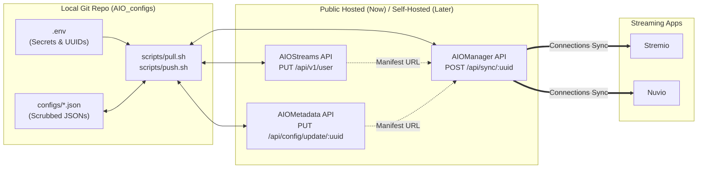

# AIO Streaming Setup — Config-as-Code (GitOps)

This repository manages the configurations for your **Stremio** + **Nuvio** streaming stack across:

1. **[AIOStreams](https://github.com/Viren070/AIOStreams)** (`configs/aiostreams.json`) — Stream scrapers, Debrid/Usenet services, SEL filtering/sorting, and stream formatting.
2. **[AIOMetadata](https://github.com/cedya77/aiometadata)** (`configs/aiometadata.json`) — TMDB/TVDB/MAL/AniList metadata providers, MDBList/Trakt catalogs, artwork rules, and search.
3. **[AIOManager](https://github.com/Sonicx161/AIOManager)** (`configs/aiomanager.json`) — Saved addon library, account profiles, Autopilot failover rules, and bidirectional Stremio $\leftrightarrow$ Nuvio sync.

---

## Architecture Overview



---

## 1. Initial Setup

1. **Create your `.env` file** from the template:
   ```bash
   cp .env.example .env
   ```
2. **Fill in `.env`**:
   * Set `AIOSTREAMS_URL`, `AIOMETADATA_URL`, and `AIOMANAGER_URL` to the public instances you currently use.
   * Set your `UUID` and `PASSWORD` for each service.
   * Fill in your `SECRET_*` API keys (Real-Debrid, TorBox, TMDB, TVDB, RPDB, MDBList, etc.).

3. **Populate `configs/` (Two Ways)**:
   * **Way A — Automatic Pull via API (Recommended):**
     ```bash
     ./scripts/pull.sh
     ```
     This downloads your live configurations from all configured instances, strips volatile server fields, replaces your API keys with `{{SECRET_*}}` placeholders, and writes clean JSON files into `configs/`.
   * **Way B — Manual UI Export + Sanitize:**
     If you exported JSON files directly from the browser UIs, save them as:
     * `configs/aiostreams.json`
     * `configs/aiometadata.json`
     * `configs/aiomanager.json`
     Then scrub all secrets before committing:
     ```bash
     ./scripts/sanitize.sh
     ```

---

## 2. Day-to-Day Git Workflow (On Public Instances)

### Pushing Local Edits to the Public Servers
1. Edit `configs/aiostreams.json`, `configs/aiometadata.json`, or `configs/aiomanager.json` in your code editor.
2. Push your changes directly to the servers (no browser copy-pasting required):
   ```bash
   # Push all three services:
   ./scripts/push.sh

   # Or push a single service:
   ./scripts/push.sh aiostreams
   ./scripts/push.sh aiometadata
   ./scripts/push.sh aiomanager
   ```
   > **Note:** Pushing updates your existing `UUID` in-place via `PUT`, so your Stremio/Nuvio addon Install URLs **never change**.

3. Commit your changes to Git:
   ```bash
   git add configs/
   git commit -m "Update stream sorting / catalogs"
   ```

### Pulling Changes Made in the Web UI
If you tweak settings visually in the AIOStreams, AIOMetadata, or AIOManager web UI:
```bash
./scripts/pull.sh
git diff configs/
```

---

## 3. Migrating from Public Hosted to Self-Hosted Later

When you are ready to host your own stack:

1. **Start the Docker stack**:
   ```bash
   cd docker
   cp .env.selfhost.example .env.selfhost
   # Edit .env.selfhost and set AIOSTREAMS_SECRET_KEY & AIOMANAGER_ENCRYPTION_KEY
   docker compose up -d
   ```

2. **Point `.env` to your new self-hosted URLs**:
   Update `AIOSTREAMS_URL`, `AIOMETADATA_URL`, and `AIOMANAGER_URL` in your root `.env` file to point to your self-hosted domains (or `http://localhost:3000`, `http://localhost:3232`, `http://localhost:1610`).

3. **Bootstrap your configs onto the new servers with `--create`**:
   ```bash
   ./scripts/push.sh aiostreams --create
   ./scripts/push.sh aiometadata --create
   ```
   The CLI will create your user configs on your new self-hosted instances and print out your **new UUIDs** and **new Install URLs**.

4. **Update `.env` and AIOManager**:
   * Paste the new `AIOSTREAMS_UUID` and `AIOMETADATA_UUID` into `.env`.
   * Replace the 2 addon URLs in **AIOManager**, which will automatically sync the new self-hosted addon URLs to both **Stremio** and **Nuvio**.

