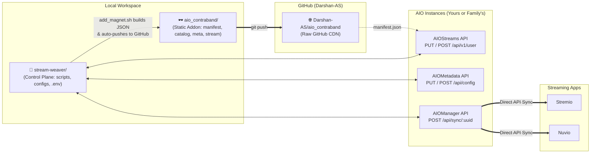

# Stream Weaver — Config-as-Code (GitOps)

This repository (**`stream-weaver`**) is the declarative GitOps control plane for your **Stremio** + **Nuvio** streaming stack, paired with **[`aio_contraband`](https://github.com/Darshan-AS/aio_contraband)** (`dev.darshanas.contraband`) for curated niche courses, rare lectures, and unlisted specials.

It manages:
1. **[AIOStreams](https://github.com/Viren070/AIOStreams)** (`configs/aiostreams.json`) — Stream scrapers, TorBox/Debrid services, SEL filtering/sorting, stream formatting, and the **Contraband** custom addon.
2. **[AIOMetadata](https://github.com/cedya77/aiometadata)** (`configs/aiometadata.json`) — TMDB/TVDB/MAL/AniList metadata providers, MDBList/Trakt catalogs, artwork rules, and search.
3. **[AIOManager](https://github.com/Sonicx161/AIOManager)** (`configs/aiomanager.json`) — Saved addon library, account profiles, Autopilot failover rules, and bidirectional Stremio $\leftrightarrow$ Nuvio sync.
4. **[Contraband Addon (`aio_contraband`)](https://github.com/Darshan-AS/aio_contraband)** (`../aio_contraband`) — Standalone static Stremio addon repository automatically built and published by `scripts/add_magnet.sh` and `scripts/build_course_metadata.py`.

---

## Dual-Repository Architecture



---

## 1. Quick Start: Spin Up Your Own AIO Instances (For Family / Friends)

If you want to replicate this exact streaming setup under **your own** AIOStreams & AIOMetadata instances (with your own TorBox / Debrid account, Trakt lists, and Stremio/Nuvio accounts):

> **Do I need to clone `aio_contraband`?**
> **No!** If you just want to *watch* the Contraband catalogs (like **Peterson Academy**), `configs/aiostreams.json` already points directly to `https://raw.githubusercontent.com/Darshan-AS/aio_contraband/main/manifest.json`. You only need `stream-weaver`.

### Step 1: Clone `stream-weaver` & Create `.env`
```bash
git clone git@github.com:Darshan-AS/stream-weaver.git
cd stream-weaver
cp .env.example .env
```

### Step 2: Fill in Your Keys in `.env`
Open `.env` and fill in:
1. **Instance URLs** (defaults to MidnightIgnite / ElfHosted public instances, or set your own):
   ```dotenv
   AIOSTREAMS_URL=https://aiostreamsfortheweebsstable.midnightignite.me
   AIOMETADATA_URL=https://aiometadatafortheweebs.midnightignite.me
   ```
2. **Choose a Password for Your New Instances** (leave `AIOSTREAMS_UUID` and `AIOMETADATA_UUID` blank for now—step 3 will create them):
   ```dotenv
   AIOSTREAMS_PASSWORD=choose-a-strong-password
   AIOMETADATA_PASSWORD=choose-a-strong-password
   ```
3. **Required API Keys** (used to populate `{{SECRET_*}}` placeholders in `configs/aiostreams.json` and `configs/aiometadata.json`):
   * `SECRET_TORBOX_API_KEY` — Your TorBox API key (from [torbox.app/settings](https://torbox.app/settings))
   * `SECRET_TMDB_API_KEY` & `SECRET_TMDB_ACCESS_TOKEN` — Free from [themoviedb.org/settings/api](https://www.themoviedb.org/settings/api)
   * `SECRET_TVDB_API_KEY` — Free from [thetvdb.com/api-information](https://thetvdb.com/api-information)
   * `SECRET_RPDB_API_KEY` — RatingPosterDB key (use `t0-free-rpdb` if on the free tier)
   * `SECRET_GEMINI_API_KEY` — Google AI Studio key for AI search in AIOMetadata
   * `SECRET_TRAKT_TOKEN_ID` — Trakt token ID (or replace with your own after signing into Trakt in AIOMetadata UI)

### Step 3: Bootstrap Your Own AIOStreams & AIOMetadata Instances (`--create`)
Run `push.sh` with `--create` to provision brand-new user profiles on the servers:
```bash
./scripts/push.sh aiostreams --create
./scripts/push.sh aiometadata --create
```
Each command will output your newly created **UUID** and **Install URL** (`manifest.json`):
1. Copy the printed `AIOSTREAMS_UUID` and `AIOMETADATA_UUID` into your `.env` file.
2. Install the two generated `manifest.json` URLs into **Stremio** / **Nuvio** (or into your own **AIOManager** profile).
3. Whenever you want to tweak your setup later, just edit `configs/*.json` and run `./scripts/push.sh aiostreams` or `./scripts/push.sh aiometadata`—it will update your UUIDs in-place without changing your Install URLs!

---

## 2. Maintainer Setup: Dual-Repo VS Code Workspace

If you are also curating and publishing new content into **[`aio_contraband`](https://github.com/Darshan-AS/aio_contraband)**:

### Step 1: Clone Both Repos Side-by-Side
```bash
mkdir -p ~/Personal && cd ~/Personal
git clone git@github.com:Darshan-AS/stream-weaver.git
git clone git@github.com:Darshan-AS/aio_contraband.git
```

### Step 2: Open the Multi-Root VS Code Workspace
Open [`stream-weaver/stream-weaver.code-workspace`](./stream-weaver.code-workspace) in VS Code (or click **"Open Workspace"** when viewing the file):
* **`🧶 Stream Weaver (Control Plane)`** — Scripts, `.env`, and `configs/*.json`
* **`🕶️ Contraband (Addon Repo)`** — Static Stremio addon (`manifest.json`, `catalog/`, `meta/`, `stream/`)
* Includes 1-click **VS Code Tasks** (`Cmd+Shift+P` $\rightarrow$ `Tasks: Run Task`) for pushing configs, syncing TorBox library, and draining the TorBox download queue.

---

## 3. Day-to-Day GitOps Workflow

### Pushing Local Config Edits to Live Instances
```bash
# Push AIOStreams, AIOMetadata, AIOManager, Nuvio & Stremio in one shot:
./scripts/push.sh

# Or push a single service:
./scripts/push.sh aiostreams
./scripts/push.sh aiometadata
./scripts/push.sh aiomanager
```
> **Note:** Pushing updates your existing `UUID` in-place via `PUT`, so your Stremio/Nuvio addon Install URLs **never change**.

### Pulling Changes Made in the Web UI
If you tweak settings visually in the AIOStreams, AIOMetadata, or AIOManager web UI:
```bash
./scripts/pull.sh
git diff configs/
```
`pull.sh` automatically harvests any new API keys into `.env` and scrubs them into `{{SECRET_*}}` placeholders in `configs/*.json` so you never accidentally commit a secret.

---

## 4. Publishing Niche Courses & Specials to Contraband (`add_magnet.sh`)

`./scripts/add_magnet.sh` adds magnet links or `.torrent` files to your **TorBox Cloud Library**, scrapes/builds episode metadata into `../aio_contraband`, **automatically commits and pushes `aio_contraband` to GitHub**, and refreshes AIOStreams:

```bash
# 1. Add a single magnet or .torrent file (auto-detects Peterson Academy, MasterClass, Wondrium, etc.)
./scripts/add_magnet.sh "magnet:?xt=urn:btih:..."

# 2. Batch-import all magnets from a Markdown/text file (queues beyond 3 active downloads on TorBox Essential)
./scripts/add_magnet.sh --from-file tpb-magnets.md

# 3. Watch & drain the TorBox queue (keeps 3 parallel downloads active & auto-publishes each finished course)
./scripts/add_magnet.sh --watch

# 4. Re-scan your TorBox Cloud Library and sync/publish all completed downloads to Contraband
./scripts/add_magnet.sh --sync-library

# 5. Scrape metadata from any webpage URL or assign to a custom catalog row (e.g. "MasterClass" or "Stand-Up Specials")
./scripts/add_magnet.sh --url "https://www.masterclass.com/classes/..." ~/Downloads/course.torrent
python3 scripts/build_course_metadata.py --hash <40-char-hash> --torrent-id <id> --collection "Stand-Up Specials" --publish

# 6. List all active, completed, and queued torrents in your TorBox Cloud Library
./scripts/add_magnet.sh --list
```

---

## 5. Migrating from Public Hosted to Self-Hosted Later

When you are ready to host your own stack via Docker:

1. **Start the Docker stack**:
   ```bash
   cd docker
   cp .env.selfhost.example .env.selfhost
   # Edit .env.selfhost and set AIOSTREAMS_SECRET_KEY & AIOMANAGER_ENCRYPTION_KEY
   docker compose up -d
   ```
2. **Point `.env` to your new self-hosted URLs** (`AIOSTREAMS_URL`, `AIOMETADATA_URL`, `AIOMANAGER_URL`).
3. **Bootstrap your configs onto the new servers with `--create`**:
   ```bash
   ./scripts/push.sh aiostreams --create
   ./scripts/push.sh aiometadata --create
   ```
4. **Update `.env` and AIOManager** with your new UUIDs and run `./scripts/push.sh`.
