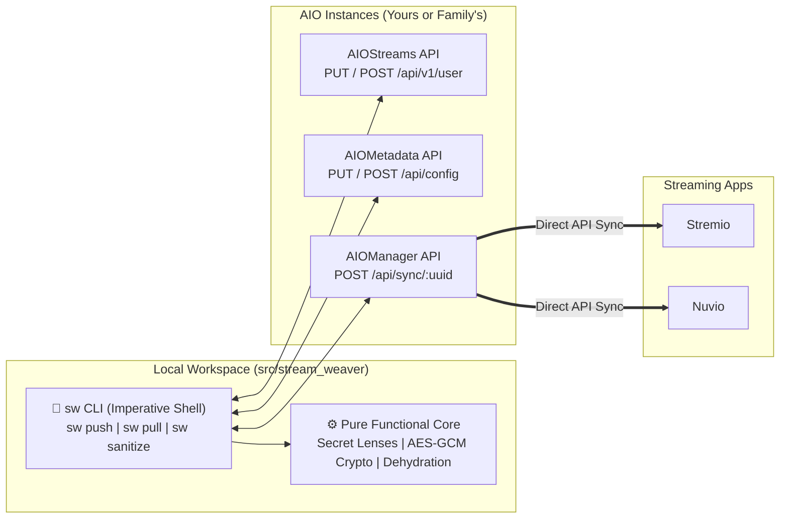

# Stream Weaver — Pure Functional Streaming Stack GitOps Control Plane

This repository (**`stream-weaver`**) is the declarative GitOps control plane for your **Stremio** + **Nuvio** streaming stack, paired with **[`aio_contraband`](https://github.com/Darshan-AS/aio_contraband)** (`dev.darshanas.contraband`) for curated niche courses, rare lectures, and unlisted specials.

It manages:
1. **[AIOStreams](https://github.com/Viren070/AIOStreams)** (`aiostreams.json`) — Stream scrapers, TorBox/Debrid services, SEL filtering/sorting, stream formatting, and the **Contraband** custom addon.
2. **[AIOMetadata](https://github.com/cedya77/aiometadata)** (`aiometadata.json`) — TMDB/TVDB/MAL/AniList metadata providers, MDBList/Trakt catalogs, artwork rules, and search.
3. **[AIOManager](https://github.com/Sonicx161/AIOManager)** (`aiomanager.json`) — Saved addon library, account profiles, Autopilot failover rules, and bidirectional Stremio $\leftrightarrow$ Nuvio sync.

> **Contraband Addon Compiler & TorBox Queue (`cb`):** The static Stremio addon compiler and TorBox ingestor now live directly inside the **[`aio_contraband`](https://github.com/Darshan-AS/aio_contraband)** repository (`../aio_contraband`) via the `cb` CLI (`uv run cb add`, `uv run cb sync`, `uv run cb watch`, `uv run cb list`).

---

## Architecture: Functional Core, Imperative Shell

`stream-weaver` is structured as a lean, strictly typed Python 3.14+ package (`src/stream_weaver/`) managed by `uv`:



### Package Layout
* `src/stream_weaver/core/` — **100% Pure Functional Core** (`@dataclass(frozen=True, slots=True)`, `Result[T, E] = Ok[T] | Err[E]`, zero I/O):
  * `secrets.py` — Declarative JSON-path `SecretLens` engine for lossless secret harvesting, scrubbing (`{{SECRET_*}}`), and injection.
  * `crypto.py` — Pure Python PBKDF2-HMAC-SHA256 + AES-256-GCM + raw deflate for AIOManager Cloud Sync (zero external Node.js dependency).
  * `coercions.py` — Pure config normalizers and AIOManager telemetry dehydration/rehydration.
* `src/stream_weaver/providers/` — **Extensible Structural Protocols (`typing.Protocol`)**:
  * `ConfigServiceProtocol` (`AIOStreamsService`, `AIOMetadataService`, `AIOManagerService`)
  * `ClientSyncProtocol` (`NuvioClientSync`, `StremioClientSync`)
* `src/stream_weaver/effects/` & `src/stream_weaver/cli/` — **Imperative Shell** (`httpx` HTTP adapter, JSON/`.env` persistence, and `typer`/`rich` CLI).

### Repository Layout: Library → Profile → Tenant
The repo separates **tool** from **data**, and data into three layers:

| Layer | What lives here | Owned by |
| :--- | :--- | :--- |
| **Library** (`library/`, `tenants/<t>/library/`) | identity-free *recipes*: collection / folder / catalog / badges / meta / settings fragments, optionally parameterised (`${language}`, `for` loops) | shared, or tenant-private when it needs a custom AIOStreams preset |
| **Profile** (`tenants/<t>/profiles/<p>/profile.json`) | one person: which instances and logins they use, which Nuvio profile, plus their *taste* — `collections` as `{ref, with}` items (or inline), `badges`/`meta`/`settings` refs, `aiometadata.extraCatalogs` | the tenant's maintainer |
| **Tenant** (`tenants/<t>/`) | identity + infrastructure: `tenant.json` (instances, logins, profiles, library roots), `.env`, raw `aiostreams.json` / `aiomanager.json`, one `aiometadata[.<instance>].json` per AIOMetadata instance | one maintainer |

The tool never assumes where a tenant lives; it is told via `--tenant <name>` (→ `./tenants/<name>`), `--dir <path>`, `STREAM_WEAVER_DIR`, or by running inside a directory containing `tenant.json`.

```text
stream-weaver/
├── src/stream_weaver/            tool (sw) — reads only the tenant dir + library roots it is given
├── library/                      shared recipes (collections/, folders/, catalogs/, badges/, meta/, settings/)
├── examples/home/                identity-free demo tenant: docs + test fixture (`sw init --from examples/home`)
├── tenants/
│   └── don/
│       ├── tenant.json           instances {aiometadata: {default, dad}}, logins {nuvio: {don}}, profiles [don, dad]
│       ├── .env                  all values (gitignored): AIOMETADATA_DAD_UUID, SECRET_NUVIO_ACCESS_TOKEN, …
│       ├── aiostreams.json       raw instance document (shared by every profile)
│       ├── aiomanager.json       raw document; accounts[] is *managed* (regenerated from profiles on push)
│       ├── aiometadata.json      instance `default` — catalogs *derived* from the profiles bound to it
│       ├── aiometadata.dad.json  instance `dad`
│       ├── profiles/{don,dad}/profile.json
│       ├── library/              tenant-private recipes (Contraband, ItsOut-dependent folders)
│       ├── architecture/ · ARCHITECTURE.md   generated
└── .github/CODEOWNERS            src/ + library/ need review; tenants/<x>/ is self-owned
```

**How a push works:** every profile is *compiled* — recipe refs are rendered, symbolic addons (`aiometadata`, `aiostreams`, `bingecat`, …) are resolved to manifest ids from the tenant's cached manifests, BingeCat rows are matched by name, AIOStreams rows by `preset` + `catalog`. The compiled documents feed three pushes: each AIOMetadata instance gets the union of catalogs its profiles reference (everything else disabled), `aiomanager.json` gets one managed account per profile (addons = instances + extras, connections = logins), and each Nuvio profile gets its collections / badges / meta / settings.

**How a pull works:** server documents are compared with each profile's rendering. Items still equal to their recipe stay `{ref}`; items edited on a device are *ejected* inline into `profile.json` (lossless — the file always compiles back to what the server has). Raw instance documents (`aiostreams.json`, `aiomanager.json`) are written back as before.

A second person who self-hosts adds `tenants/<name>/` (`uv run sw init tenants/<name> --from examples/home`), gets the shared library for free, and runs every command with `--tenant <name>`.

---

## 1. Quick Start: Replicate This Setup on Your Own Accounts

> **Visual Web Studio (`sw studio`) or Terminal CLI — Your Choice!**
> Prefer a visual browser configurator with live Nuvio folder cover previews, Debrid/pack switches, and a one-click **Save & Push to Nuvio** button? After `uv sync`, run:
> * **Local GitOps Studio:** `uv run sw init tenants/<you> --from examples/home && uv run sw studio --tenant <you>`
> * **Zero-Disk Hosted / Stateless Studio:** `uv run sw studio --stateless` *(keys stay in browser `localStorage`; includes 1-click **Export Repo (.zip)**)*

> **Do I need AIOManager or `aio_contraband`?**
> * **AIOManager is optional:** `sw push` syncs addons, Home Collections, stream badges, details-page enrichment, and app settings **directly to Nuvio** whenever `AIOMANAGER_UUID` is left blank.
> * **`aio_contraband` is optional:** `examples/home` ships all 7 curated collections (30+ folders) out of the box without Contraband. To also add the **Peterson Academy** tab, see [Optional: Enable Contraband](#optional-enable-contraband-peterson-academy) below.

### Step 1: Clone `stream-weaver`, Install Dependencies & Scaffold Your Tenant
```bash
git clone git@github.com:Darshan-AS/stream-weaver.git
cd stream-weaver
uv sync
uv run sw init tenants/<you> --from examples/home   # tenant.json, .env, starter documents & 7 collections
```
Every `sw` command below takes `--tenant <you>` (or `cd tenants/<you>` first).

### Step 2: Fill in Your Keys in `tenants/<you>/.env`
Open `tenants/<you>/.env` and fill in:
1. **Instance URLs** (hosted instances such as ElfHosted / MidnightIgnite, or your own via [`docker/docker-compose.yml`](docker/docker-compose.yml)):
   ```dotenv
   AIOSTREAMS_URL=https://aiostreams.elfhosted.com
   AIOMETADATA_URL=https://aiometadata.elfhosted.com
   ```
2. **Choose Passwords for Your New Instances** (leave `AIOSTREAMS_UUID` and `AIOMETADATA_UUID` blank—Step 3 creates and saves them automatically):
   ```dotenv
   AIOSTREAMS_PASSWORD=choose-a-strong-password
   AIOMETADATA_PASSWORD=choose-a-strong-password
   ```
3. **API Keys & Addon Tokens** (injected into `{{SECRET_*}}` placeholders at push time):
   * `SECRET_TORBOX_API_KEY` — Paid debrid backend from [torbox.app/settings](https://torbox.app/settings) (powers cached Group 1 scrapers + TorBox Cloud Library)
   * `SECRET_TMDB_API_KEY` & `SECRET_TMDB_ACCESS_TOKEN` — Free from [themoviedb.org/settings/api](https://www.themoviedb.org/settings/api) (AIOMetadata + Nuvio hero trailers & details enrichment)
   * `SECRET_TVDB_API_KEY` — Free from [thetvdb.com/api-information](https://thetvdb.com/api-information) (series & anime metadata)
   * `SECRET_RPDB_API_KEY` — RatingPosterDB key (`t0-free-rpdb` works on the free tier)
   * `SECRET_MDBLIST_API_KEY` — Free from [mdblist.com/preferences](https://mdblist.com/preferences) (powers the 8-source ratings bar on Nuvio details pages; if left blank, `nuvio_meta` is skipped with a warning)
   * `SECRET_TRAKT_TOKEN_ID` — Token ID generated by authenticating Trakt on your AIOMetadata instance's Configure page
   * `SECRET_BINGECAT_TOKEN` — Token from your `https://bingecat.com/stremio/<token>/manifest.json` URL at [bingecat.com](https://bingecat.com) (toggle **AI-Assisted Search** on there if you want AI search rows)
   * `SECRET_ITSOUT_TOKEN` — Token from `https://itsout.elfhosted.com/configure` (powers digital release alerts)
   * `SECRET_SUBSOURCE_API_KEY` — Free key from [subsource.net](https://subsource.net) (powers SubSource + the 3 Strelingo dual-subtitle addons)

### Step 3: Provision AIOStreams & AIOMetadata, Sign In to Nuvio, and Push
1. **Sign in to the Nuvio app at least once** on each device you use (`tv`, `desktop`, `mobile`) so Nuvio initialises that platform's profile settings blob in cloud sync (and optionally link Trakt inside Nuvio for Continue Watching / comments).
2. **Create your AIOStreams & AIOMetadata instances** (this automatically writes `AIOSTREAMS_UUID`, `SECRET_AIOSTREAMS_ENCRYPTED_PASSWORD`, and `AIOMETADATA_UUID` into `.env`):
   ```bash
   uv run sw push aiostreams --create --tenant <you>
   uv run sw push aiometadata --create --tenant <you>
   ```
3. **Sign in to Nuvio via `sw` and push your full stack:**
   ```bash
   uv run sw login nuvio --login don --tenant <you>
   uv run sw push --tenant <you>
   ```
   `sw push` refreshes your live AIOStreams / AIOMetadata / BingeCat manifests so your personal BingeCat list IDs resolve automatically, then syncs your addons, all 7 Home Collections, `Elite-Badges`, MDBList/TMDB details enrichment, and app settings straight to Nuvio Profile #1 (or pass `--nuvio-profile` / edit `profiles/don/profile.json` to target another profile from `uv run sw profile nuvio-list --login don --tenant <you>`).
4. *(Optional — AIOManager & Stremio)*: If you also use **AIOManager** Cloud Sync, fill `AIOMANAGER_URL`, `AIOMANAGER_UUID`, and `AIOMANAGER_SYNC_PASSWORD` in `.env`. Either sign in to Stremio (`uv run sw login stremio --login don --tenant <you>`) or delete `"stremio": {"login": "don"}` from `tenants/<you>/profiles/don/profile.json` if you only use Nuvio.

#### Optional: Enable Contraband (Peterson Academy)
If you also want the **Peterson Academy** folder inside *Courses & Documentaries*:
1. Copy [`tenants/don/library/folders/fld-peterson-academy.json`](tenants/don/library/folders/fld-peterson-academy.json) into `tenants/<you>/library/folders/` and add `{"ref": "fld-peterson-academy"}` to `tenants/<you>/library/collections/col-courses-docs.json`.
2. Copy the `"swc"` preset (`https://raw.githubusercontent.com/Darshan-AS/aio_contraband/main/manifest.json`) and `"swc"` group entry from [`tenants/don/aiostreams.json`](tenants/don/aiostreams.json) into `tenants/<you>/aiostreams.json`, then run `uv run sw push --tenant <you>`. *(Note: Contraband streams use BitTorrent `infoHash`es, which play instantly when cached in TorBox.)*

---

## 2. Day-to-Day GitOps Workflow (`sw`)

### Pushing Local Config Edits to Live Instances
```bash
# Push AIOStreams, AIOMetadata, AIOManager, Nuvio & Stremio in one shot:
uv run sw push

# Or push a single service:
uv run sw push aiostreams
uv run sw push aiometadata
uv run sw push aiomanager

# Or push only the Nuvio client-side profile settings (no AIOManager round-trip):
uv run sw push nuvio              # addons + collections + badges + meta enrichment + app settings
uv run sw push nuvio_collections  # Home screen folders only
uv run sw push nuvio_badges       # stream badge packs only
uv run sw push nuvio_meta         # details-page enrichment only (see below)
uv run sw push nuvio_settings     # playback / subtitles / audio / theme / TV layout (see below)
```

### People: Profiles, Instances, Logins
```bash
uv run sw profile list --tenant don                      # who exists, which instances/logins/collections
uv run sw profile import "Don" --name don                # migrate an existing AIOManager account into a profile
uv run sw profile nuvio-list --login don                 # Nuvio profiles (index, name, id) on a login
uv run sw profile new dad --aiometadata dad --nuvio-login don --nuvio-profile Dad --extras-from don

uv run sw instance list                                   # named service instances + readiness
uv run sw instance new aiometadata dad --from tenants/don/aiometadata.json
uv run sw push aiometadata --profile dad --create         # provision it; UUID written to AIOMETADATA_DAD_UUID

uv run sw login nuvio --login gf                          # own Nuvio account → SECRET_NUVIO_GF_*
uv run sw login adopt nuvio --login don --prefix NUVIO    # register already-present SECRET_NUVIO_* keys
uv run sw login list

uv run sw push --profile dad                              # scope Nuvio sync + instance bindings to one profile
```

### Recipes: the Library
```bash
uv run sw library list                                    # every recipe, params, and which root it comes from
uv run sw library show folder regional-movies -w language=kn -w slug=kannada -w label=Kannada
uv run sw migrate compose                                 # lift legacy root nuvio_*.json into recipes + refs (golden-gated)
```
A profile composes recipes:
```jsonc
"collections": [
  { "ref": "regional-cinema", "with": { "language": "kn", "slug": "kannada", "label": "Kannada" } },
  { "ref": "col-discover" },
  { "ref": "col-streaming-services" },
  { "id": "col-mine", "title": "Mine", "folders": [ /* inline folder, symbolic sources */ ] }
]
```
Recipe templates are deliberately tiny: `${param}` substitution, `${item.key}` one-level access, `{"for": x, "in": "${list}", "item": …}` and `{"if": "${flag}", "item": …}` inside lists. Nothing else.

### Nuvio Stream Badges (`library/badges/*.json`)
`nuvio_badges.json` declaratively syncs regex-matched technology logo packs (such as
[Elite-Badges](https://github.com/leonevz/Elite-Badges)) into `stream_badge_settings` across `tv`,
`desktop`, and `mobile` via `sync_push_profile_settings_blob`—configuring stream-card badge
placement (`BOTTOM` / `TOP`), player seek-bar badges (`showInPlayer`), addon logos, and file-size
chips while preserving unrelated profile preferences.

### Nuvio Details-Page Enrichment (`library/meta/*.json`)
The Stremio addon protocol only carries a single `imdbRating`; the multi-source ratings strip,
Trakt reviews, and TMDB extras on a Nuvio details page are **client-side integrations** that
Nuvio stores per profile in its cloud sync (`sync_push_profile_settings_blob` +
`sync_push_provider_credentials`). `nuvio_meta.json` drives all of them declaratively
across `tv`, `desktop`, and `mobile` so nothing has to be toggled in the app UI:

| Block | What it switches on | Nuvio feature it writes |
| :--- | :--- | :--- |
| `ratings` | MDBList ratings row: IMDb, TMDB, Rotten Tomatoes critics (`tomatoes`) + audience, Metacritic, Trakt, Letterboxd, MAL | `mdblist_settings` (+ `mdblist` provider credential) |
| `tmdbEnrichment` | Trailers, logos/artwork, credits → tappable people, networks, production companies, release dates, season posters, collections, More Like This | `tmdb_settings` (+ `tmdb` provider credential) |
| `traktComments` | Trakt reviews section on movie/series pages | `trakt_comments_settings` (desktop/mobile), `trakt_settings.show_meta_comments` (TV) |
| `metaScreen` | Section visibility/order (`COMMENTS`, `PRODUCTION`, `DETAILS`, …), background mode, hero trailer autoplay, tab layout, episode card style | `meta_screen_settings_payload` (desktop/mobile; set to `null` to leave devices untouched) |

Required `.env` keys: `SECRET_MDBLIST_API_KEY` (free, https://mdblist.com/preferences → API Access)
and `SECRET_TMDB_API_KEY` (already used by AIOMetadata). Merges are read-modify-write per platform:
unrelated preferences (theme, player, Trakt watch-progress source, …) are preserved, and
never-initialised desktop/mobile profiles are skipped rather than seeded with partial defaults.

### Nuvio App Settings (`library/settings/*.json`)
Everything else you would otherwise toggle by hand in each Nuvio client's Settings screens lives
in `nuvio_settings.json` and is pushed into the same per-platform profile blobs
(`sync_push_profile_settings_blob`) with read-modify-write merges, so device-local knobs
(decoders, libmpv/iOS tuning, buffers, per-title track memory) are never touched:

| Block | What it drives | Highlights |
| :--- | :--- | :--- |
| `playback` | Player behaviour on `tv` / `desktop` / `mobile` | **`reuseLastLink`** (auto-play the last working stream for the same title while the cache is valid), auto stream selection, next-episode auto-play & binge groups, IntroDB skip + auto-skip segments, AnimeSkip, overlays, external player |
| `audio` / `subtitles` | Track preferences & subtitle styling | preferred/secondary languages, forced subs, SDH stripping, addon startup mode, colours/outline/size, TV HDR subtitle style |
| `appearance` | Theme & navigation chrome | theme, AMOLED black, nav bar style, desktop sidebar/top bar, TV font & settings UI style |
| `tvLayout` | NuvioTV-only Home layout | Modern/Grid/Classic home, hero, sidebar, Discover location, poster card size, focused-poster trailers, card depth, Continue Watching row, detail-page toggles, perf flags |
| `notifications` / `tvPlugins` | Misc | episode release alerts (mobile/desktop), group plugin streams by repository (TV) |

Each block may be set to `null` (or omitted) to leave that area untouched on every device; any
leaf key omitted inside a declared block falls back to Nuvio's in-app default. Values are
platform-neutral — the compiler (`src/stream_weaver/core/nuvio_settings.py`, a single
table-driven registry) translates key names, enum spellings, colour encodings and per-platform
capability gaps (e.g. `movie-credits` auto-skip is TV-only, some themes are desktop/TV-only).
Optional secrets: `SECRET_ANIMESKIP_CLIENT_ID`, `SECRET_INTRODB_API_KEY` (pushed via Nuvio's
provider-credential RPCs; leave blank to keep whatever each device already has).

### Pulling Changes Made in the Web UI
If you tweak settings visually in the AIOStreams, AIOMetadata, or AIOManager web UI:
```bash
uv run sw pull --tenant <you>
git diff tenants/<you>/          # raw docs rewritten; device edits to Home/badges/settings ejected into profiles/*/profile.json
```
`sw pull` automatically harvests any new API keys into `.env`, dehydrates volatile runtime telemetry (`watchEvents`, `changelog`, duplicate cached manifests), and scrubs secrets into `{{SECRET_*}}` placeholders via JSON-path lenses.

### Sanitizing Manually Exported Config Files
```bash
uv run sw sanitize
```

### Self-Updating Architecture Topology (`LikeC4` & `ARCHITECTURE.md`)
`stream-weaver` automatically compiles each tenant's JSON documents into an interactive **LikeC4** model (`tenants/<you>/architecture/topology.c4`) and a GitHub-rendered Markdown overview (e.g. [`tenants/don/ARCHITECTURE.md`](tenants/don/ARCHITECTURE.md)) on every `sw pull`, `sw push`, `sw sanitize`, and `git commit`:
```bash
# Manually regenerate or check for drift:
uv run sw diagram
uv run sw diagram --check

# Launch the interactive LikeC4 zoomable architecture explorer:
npx likec4 start tenants/<you>/architecture
```

### Offline Validation (CI gate)
```bash
uv run sw validate --tenant <you>   # tenant.json schema, document normalization, architecture sync
uv run sw validate --all-tenants    # what CI runs on every PR
```

---

## 3. Development & Verification Suite

Run the full linter, strict type-checker, and unit + property-based (`hypothesis`) test suite:
```bash
uv run ruff check src tests
uv run mypy src tests
uv run pytest
```
