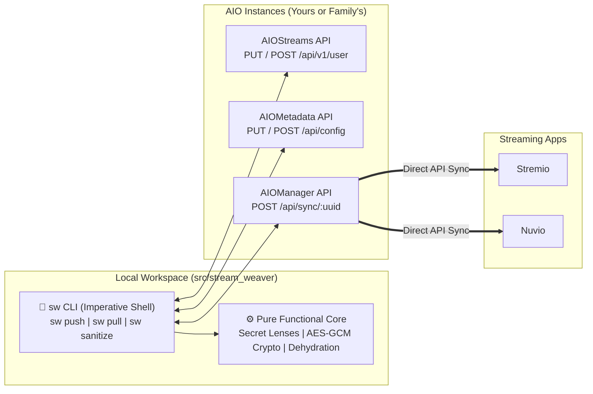

# Stream Weaver — Pure Functional Streaming Stack GitOps Control Plane

This repository (**`stream-weaver`**) is the declarative GitOps control plane for your **Stremio** + **Nuvio** streaming stack, paired with **[`aio_contraband`](https://github.com/Darshan-AS/aio_contraband)** (`dev.darshanas.contraband`) for curated niche courses, rare lectures, and unlisted specials.

It manages:
1. **[AIOStreams](https://github.com/Viren070/AIOStreams)** (`configs/aiostreams.json`) — Stream scrapers, TorBox/Debrid services, SEL filtering/sorting, stream formatting, and the **Contraband** custom addon.
2. **[AIOMetadata](https://github.com/cedya77/aiometadata)** (`configs/aiometadata.json`) — TMDB/TVDB/MAL/AniList metadata providers, MDBList/Trakt catalogs, artwork rules, and search.
3. **[AIOManager](https://github.com/Sonicx161/AIOManager)** (`configs/aiomanager.json`) — Saved addon library, account profiles, Autopilot failover rules, and bidirectional Stremio $\leftrightarrow$ Nuvio sync.

> **Contraband Addon Compiler & TorBox Queue (`cb`):** The static Stremio addon compiler and TorBox ingestor now live directly inside the **[`aio_contraband`](https://github.com/Darshan-AS/aio_contraband)** repository (`../aio_contraband`) via the `cb` CLI (`uv run cb add`, `uv run cb sync`, `uv run cb watch`, `uv run cb list`).

---

## Architecture: Functional Core, Imperative Shell

`stream-weaver` is structured as a lean, strictly typed Python 3.12+ package (`src/stream_weaver/`) managed by `uv`:



### Package Layout
* `src/stream_weaver/core/` — **100% Pure Functional Core** (`@dataclass(frozen=True, slots=True)`, `Result[T, E] = Ok[T] | Err[E]`, zero I/O):
  * `secrets.py` — Declarative JSON-path `SecretLens` engine for lossless secret harvesting, scrubbing (`{{SECRET_*}}`), and injection.
  * `crypto.py` — Pure Python PBKDF2-HMAC-SHA256 + AES-256-GCM + raw deflate for AIOManager Cloud Sync (zero external Node.js dependency).
  * `coercions.py` — Pure config normalizers and AIOManager telemetry dehydration/rehydration.
* `src/stream_weaver/providers/` — **Extensible Structural Protocols (`typing.Protocol`)**:
  * `ConfigServiceProtocol` (`AIOStreamsService`, `AIOMetadataService`, `AIOManagerService`)
  * `ClientSyncProtocol` (`NuvioClientSync`, `StremioClientSync`)
* `src/stream_weaver/effects/` & `src/stream_weaver/cli/` — **Imperative Shell** (`httpx` HTTP adapter, JSON/`.env` persistence, and `typer`/`rich` CLI).

---

## 1. Quick Start: Spin Up Your Own AIO Instances (For Family / Friends)

> **Do I need to clone `aio_contraband`?**
> **No!** If you just want to *watch* the Contraband catalogs (like **Peterson Academy**), `configs/aiostreams.json` already points directly to `https://raw.githubusercontent.com/Darshan-AS/aio_contraband/main/manifest.json`. You only need `stream-weaver`.

### Step 1: Clone `stream-weaver`, Install Dependencies & Create `.env`
```bash
git clone git@github.com:Darshan-AS/stream-weaver.git
cd stream-weaver
uv sync
cp .env.example .env
```

### Step 2: Fill in Your Keys in `.env`
Open `.env` and fill in:
1. **Instance URLs**:
   ```dotenv
   AIOSTREAMS_URL=https://aiostreamsfortheweebsstable.midnightignite.me
   AIOMETADATA_URL=https://aiometadatafortheweebs.midnightignite.me
   ```
2. **Choose a Password for Your New Instances** (leave `AIOSTREAMS_UUID` and `AIOMETADATA_UUID` blank for now—step 3 will create them):
   ```dotenv
   AIOSTREAMS_PASSWORD=choose-a-strong-password
   AIOMETADATA_PASSWORD=choose-a-strong-password
   ```
3. **Required API Keys** (used to populate `{{SECRET_*}}` placeholders in `configs/aiostreams.json` and `configs/aiometadata.json`):
   * `SECRET_TORBOX_API_KEY` — Your TorBox API key (from [torbox.app/settings](https://torbox.app/settings))
   * `SECRET_TMDB_API_KEY` & `SECRET_TMDB_ACCESS_TOKEN` — Free from [themoviedb.org/settings/api](https://www.themoviedb.org/settings/api)
   * `SECRET_TVDB_API_KEY` — Free from [thetvdb.com/api-information](https://thetvdb.com/api-information)
   * `SECRET_RPDB_API_KEY` — RatingPosterDB key (use `t0-free-rpdb` if on the free tier)
   * `SECRET_GEMINI_API_KEY` — Google AI Studio key for AI search in AIOMetadata
   * `SECRET_TRAKT_TOKEN_ID` — Trakt token ID
   * `SECRET_BINGECAT_TOKEN` — Your BingeCat profile UUID/token (from your `https://bingecat.com/stremio/<token>/manifest.json` URL)

### Step 3: Bootstrap Your Own AIOStreams & AIOMetadata Instances (`--create`)
Run `sw push` with `--create` to provision brand-new user profiles on the servers:
```bash
uv run sw push aiostreams --create
uv run sw push aiometadata --create
```
Each command will output your newly created **UUID** and **Install URL** (`manifest.json`):
1. Copy the printed `AIOSTREAMS_UUID` and `AIOMETADATA_UUID` into your `.env` file.
2. Install the two generated `manifest.json` URLs into **Stremio** / **Nuvio** (or into your own **AIOManager** profile).
3. Whenever you want to tweak your setup later, just edit `configs/*.json` and run `uv run sw push`—it will update your UUIDs in-place without changing your Install URLs!

---

## 2. Day-to-Day GitOps Workflow (`sw`)

### Pushing Local Config Edits to Live Instances
```bash
# Push AIOStreams, AIOMetadata, AIOManager, Nuvio & Stremio in one shot:
uv run sw push

# Or push a single service:
uv run sw push aiostreams
uv run sw push aiometadata
uv run sw push aiomanager
```

### Pulling Changes Made in the Web UI
If you tweak settings visually in the AIOStreams, AIOMetadata, or AIOManager web UI:
```bash
uv run sw pull
git diff configs/
```
`sw pull` automatically harvests any new API keys into `.env`, dehydrates volatile runtime telemetry (`watchEvents`, `changelog`, duplicate cached manifests), and scrubs secrets into `{{SECRET_*}}` placeholders via JSON-path lenses.

### Sanitizing Manually Exported Config Files
```bash
uv run sw sanitize
```

---

## 3. Development & Verification Suite

Run the full linter, strict type-checker, and unit + property-based (`hypothesis`) test suite:
```bash
uv run ruff check src tests
uv run mypy src tests
uv run pytest
```
